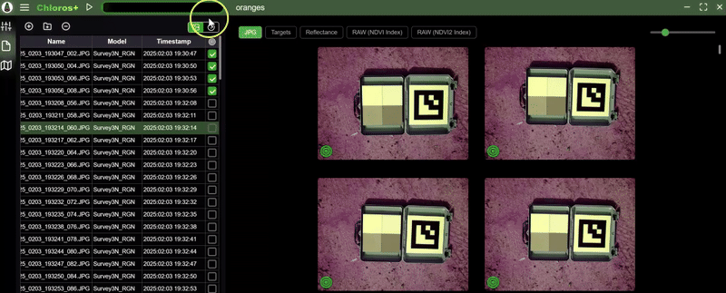

# Mise en route

<figure><figcaption></figcaption></figure>

Chloros est un logiciel développé par [MAPIR](https://www.mapir.camera) permettant de traiter des images multispectrales, de contrôler en temps réel le matériel MAPIR et d'enregistrer les données des capteurs. Chloros 1.3.0 prend en charge l'ensemble de la gamme de produits MAPIR :

* **Caméras Survey3** — traitent les captures RAW+JPG pour générer des cartes calibrées de réflectance et d’indices de végétation. Voir [Caméras prises en charge](supported-cameras.md).
* **Caméras LATTICE** — connectez en temps réel les modules de caméras multispectrales GigE, individuellement ou sous forme de réseaux multicaméras synchronisés : prévisualisez, capturez et traitez les données pour obtenir des produits calibrés de radiance et de réflectance. Voir la [section LATTICE](lattice/README.md).
* **Capteurs de lumière DAQ** — Capteurs spectraux DAQ-U (USB), DAQ-M (Bluetooth), DAQ-E et DAQ-E-S (Ethernet) : spectres calibrés en temps réel, enregistrements `.daq` et éclairage descendant pour le traitement de la réflectance. Voir la [section DAQ](daq/README.md).


**Nouveautés de Chloros 1.3.0** : les assistants IA peuvent piloter Chloros via `chloros-mcp`, et l’CLI, le SDK et `chloros-mcp` offrent les mêmes fonctionnalités. Les produits LATTICE index ont été améliorés, les matrices de capteurs complètes sont plus rapides et fonctionnent sur n'importe quel réseau, et le backend continue de fonctionner entre les commandes. Consultez la liste des nouveautés ci-dessous et [téléchargez](download.md) les programmes d'installation.



**Vous utilisez Chloros avec un assistant IA ?** Ce manuel est conçu pour cela. Demandez à votre assistant :

* `https://mapir.gitbook.io/chloros/llms.txt` — index lisible par machine de toutes les pages.
* N'importe quelle page au format Markdown brut — ajoutez `.md` à son URL (par ex. `https://mapir.gitbook.io/chloros/reference/cli-reference.md`).
* La [Référence CLI](reference/cli-reference.md) et la [Référence SDK](reference/sdk-reference.md) — des pages de référence complètes, contenant des valeurs exactes, rédigées pour être utilisées par les modèles de langage de grande envergure (LLM).

Exemple de prompt : *« Lisez https://mapir.gitbook.io/chloros/reference/cli-reference.md,, puis écrivez un script qui se connecte et traite le dossier ~/flights/flight_001 pour le convertir en fichiers GeoTIFF de réflectance et d’NDVI. »*

Ou lancez directement Chloros : `chloros-mcp`, un serveur MCP installé avec le SDK, fonctionne avec Claude Desktop, Claude Code, Cursor et d’autres clients MCP.

Guide complet : [Utilisation d’Chloros avec des assistants IA](ai-assistants.md).


***

## Nouveautés de Chloros 1.3.0

* **Les assistants IA peuvent piloter Chloros.** `chloros-mcp`, un serveur MCP installé avec le SDK Python pour Chloros, permet à Claude Desktop, Claude Code, Cursor et d’autres clients MCP de traiter des images et de piloter des caméras LATTICE, des réseaux de caméras et des capteurs de lumière DAQ. Voir [Utilisation de Chloros avec des assistants IA](ai-assistants.md).
* **L'CLI, le SDK et `chloros-mcp` offrent les mêmes fonctionnalités.** Seules la connexion, la configuration DAQ-E et les serveurs DAQ directs restent réservés à l'CLI, pour des raisons de sécurité. Certains scripts de la version 1.2.0 doivent être modifiés : voir la section **Modifications apportées dans la version 1.3.0** en haut de la [Référence CLI](reference/cli-reference.md) et de la [Référence SDK](reference/sdk-reference.md).
* **Amélioration des indices LATTICE.** L’NDVI et les autres indices exportés à partir des captures LATTICE ont été améliorés, quel que soit le mode de traitement.
* **Options du programme d’installation Windows.**Sous**Paramètres système**, le programme d’installation propose les options**Activer les chemins d’accès longs Windows**et**Exclure le backend Chloros de l’analyse Microsoft Defender**, toutes deux cochées par défaut. La première permet aux dossiers de projet d’avoir un chemin d’accès de plus de 260 caractères ; la seconde empêche l’analyse en temps réel de ralentir la capture de la caméra (environ 30 % du débit de capture à des débits élevés). Le programme d’installation ajoute désormais le dossier CLI à `PATH` une seule fois et supprime les entrées en double laissées par les versions précédentes. Voir [Téléchargement](download.md).
* **Les dossiers de projet trop profonds sont refusés d’emblée.** Lorsque les chemins d’accès longs de Windows sont désactivés (configuration par défaut de Windows), un dossier de projet trop profond pour la limite de 260 caractères est refusé avant même que l’exécution ne commence ; le programme affiche alors le dossier de projet le plus long compatible et explique comment activer les chemins d’accès longs. Auparavant, une telle exécution ne générait aucun produit. Lorsque les chemins d’accès longs sont activés, les produits situés dans des dossiers très profonds conservent désormais leurs métadonnées (balises GPS et XMP).
* **Masques de limitation.** Lorsque le démixage de bandes d’un produit de radiance ou de réflectance LATTICE produit une valeur de bande négative, cette valeur est limitée à zéro, et un masque par pixel, situé dans un dossier `clamp_masks/` à côté des dossiers de produits, enregistre quels pixels et quelles bandes ont été affectés. Le produit nomme son masque dans la balise `Chloros:UnmixClampMask`. Les vues en temps réel effectuent désormais le écrêtage exactement comme lors de l’exportation. Voir [Formats d’images de sortie](output-image-formats.md).
* **Les produits se décrivent eux-mêmes.** Les produits d’index comportent leurs propres balises de traitement (`Chloros:ProcessingLevel=index`, l’expression d’index, et s’ils ont été calculés à partir de la radiance ou de la réflectance) au lieu de celles du fichier brut source. Les produits Survey3 comportent des balises de traitement Chloros dans chaque mode de traitement. Les fichiers bruts et débayérisés LATTICE conservent l’orientation native du capteur et enregistrent cette orientation dans le fichier XMP ; la visionneuse d’images les fait pivoter uniquement à des fins d’affichage.
* **Les paquets Linux s sont livrés décompressés.** Le backend et l’interface CLI sont installés sous forme de dossiers dans le répertoire `/usr/lib/chloros/` ; ils ne se décompressent donc plus à chaque lancement. Sur x86_64, le backend ne met plus environ 100 secondes à démarrer, et le fichier `.deb` a environ la moitié de sa taille initiale. L’ExifTool fourni fonctionne désormais sur une installation Ubuntu vierge. Le répertoire `.deb` installe désormais également le Python SDK pour le système `python3` (à installer avec `sudo apt install ./chloros_1.3.0_<arch>.deb`), augmente la taille des tampons de réception des sockets du noyau nécessaires aux flux de la caméra et ajoute un service backend s’exécutant sous votre compte utilisateur. Le paquet Jetson, `chloros_1.3.0_arm64_jp6.deb`, est conçu pour JetPack 6 et effectue les traitements sur le GPU du Jetson à l’aide de la version CUDA de PyTorch fournie par JetPack. Sous Linux, chaque image exportée n'est désormais enregistrée sur le disque qu'une seule fois (écrite et balisée en mémoire, puis copiée à l'emplacement prévu) : sur un Jetson, où le disque détermine la vitesse d'exécution, une exécution de LATTICE sur 288 images prend 14 minutes au lieu de 24. Voir [Installation sous Linux](linux/linux-installation.md).
* **Les caméras LATTICE OCN offrent une lecture plus précise en plein soleil.** La radiance, la réflectance et les indices bénéficient d’une correction rapide après le démixage des bandes, de sorte qu’une cible grise affiche une valeur NDVI proche de la neutralité au soleil. Les caméras RGN restent inchangées.
* **Signalement de bogues depuis l’application.** Une icône de bogue en haut de l’onglet « Journal de débogage » envoie à MAPIR une description, jusqu’à 10 images, les journaux et les détails du système. Voir [GUI : Navigation](navigation.md).
* **Matrices LATTICE.**Par défaut, les matrices conservent la pleine résolution du capteur, et le transport compressé en 12 bits (`--packed`, par défaut `auto`) augmente la fréquence d’images en pleine résolution d’environ un tiers ; un réseau fonctionne sur n’importe quel réseau à la fréquence d’images qu’il permet (une liaison lente réduit la fréquence d’images au lieu de refuser le réseau ou de réduire la taille de ses images) ; un réseau dont les caméras subissent un redémarrage s’en remet de lui-même, avec le PTP réactivé ; l’exposition automatique ne réduit plus cette fréquence en basse lumière (elle remplit la période, puis augmente le gain) ; la capture en continu suit le rythme des réseaux rapides ; une commande**Highlights** pour les caméras RGB ; et le SDK `ArraySession` bénéficie des fonctionnalités `grab()`, `frame_stream()` et `continuous()`. Voir la [section LATTICE](lattice/README.md).
* **Exposition automatique plus stable.** L’exposition reste constante en présence d’une luminosité stable et se stabilise en quelques secondes après un changement ; les petites zones surexposées n’assombrissent plus la scène ; une exposition manuelle laisse le gain en mode Auto ; et une caméra qui cesse de répondre en plein soleil est maintenue au niveau correspondant à sa luminosité, mesurée par le capteur de lumière ou, en l’absence de capteur, par les images de la caméra elle-même. Voir [Réglages de la caméra](lattice/camera-settings.md).
* **Capteurs de lumière.** **Prise en charge du DAQ-E-S :** son diffuseur fixe ne nécessite aucune correction de cap, et chaque mesure intègre l’inclinaison, le roulis et le tangage de l’appareil. Un enregistrement indique si son capuchon a été sélectionné ou supposé, et le traitement émet un avertissement en cas de capuchon supposé : les modèles DAQ-U, DAQ-M et DAQ-E sont livrés sans capuchon ; il convient donc de nommer celui qui est installé. Les enregistrements en direct `.daq` survivent à une coupure de courant (conservez un fichier `.daq-journal` avec son `.daq`), et un DAQ-E qui cesse de transmettre est reconnecté avec l'interruption marquée dans son enregistrement. Un projet ne contenant que des enregistrements de capteurs de lumière les répertorie et les traite depuis l’application et l’CLI ; un enregistrement réalisé avec le `chloros_scripts` est répertorié sous le nom du DAQ qui l’a généré, avec une limite que vous pouvez définir. Chaque capture enregistre la valeur du DAQ utilisée. Voir la [section DAQ](daq/README.md).
* **Traitement.**Les trames LATTICE commencent à être traitées dès la détection d’une cible. Les références de cible et de DAQ sont déterminées par bande. Un projet déplacé réassocie ses fichiers. Les exportations d’une capture 8 bits sont au format 8 bits, avec un nouveau format**TIFF (8 bits)**. Une session Survey3 effectuée sans cible d’étalonnage est enregistrée en tant que produit de secours (`Vignette_Corrected_Images` ou `Sensor_Response_Images`), et non en tant qu’image de réflectance. Les balises DLS par bande d’une image de réflectance correspondent toujours à celles de sa propre image. La fonction « Texture Aware » est refusée pour les captures LATTICE, qui utilisent toujours le débayérisation standard.
* **CLI et SDK.** Les chemins de sortie relatifs aboutissent désormais dans le dossier à partir duquel vous exécutez la commande ou le script (auparavant, un backend installé les résolvait dans son propre dossier d’installation, ce qui entraînait un échec). Le backend continue de fonctionner entre les commandes et les scripts et s’arrête automatiquement après 30 minutes d’inactivité ; les commandes `chloros-cli backend status` et `backend stop` gèrent ce comportement. Les commandes de capture répertorient tous les fichiers qu’elles n’ont pas pu écrire et se terminent avec le code 1 ; les captures répétées s’arrêtent lorsque le disque est plein. Une exécution réussie de `process` génère un rapport `Image products written: N (plus M clamp masks)`. Sous Windows, les commandes `ChlorosLocal` / `process_folder` du SDK détecte le backend installé (et utilise celui qui est déjà en cours d’exécution), tandis que `read_image_audit_tags` fonctionne à partir d’un simple `pip install`.

***

## Nouveautés de Chloros 1.2.0

* **Contrôle des caméras en direct — nouvel onglet « Caméras ».** Connectez des caméras LATTICE une par une ou sous forme de réseaux multicaméras synchronisés (synchronisation temporelle PTP, capture déclenchée par le matériel), avec superpositions d’aperçu en direct, histogrammes par bande, exposition automatique intelligente, calculateur d’indice en direct et mises à jour du micrologiciel des caméras depuis l’application.
* **Capteurs de lumière — nouvel onglet « Capteurs de lumière ».** Connectez des capteurs DAQ-U (USB), DAQ-M (Bluetooth) et DAQ-E (Ethernet) ; visualisez des spectres calibrés en temps réel (W/m²/nm), enregistrez des fichiers `.daq` dans votre projet, sélectionnez des profils de correction de cap et mettez à jour le micrologiciel DAQ-E via le réseau.
* **Modes de capture et enregistreurs.** Capture unique / continue / par intervalle, plus un mode « Capture la plus rapide » en format brut uniquement ; sélection par projet des caméras et des types d’exportation générés par « Capture tout » ; enregistreurs matriciels pour des vidéos indexées de qualité surveillance et des rafales brutes de qualité analyse avec création de vidéos hors ligne.
* **Pipeline de traitement LATTICE.** Importez des dossiers de capture LATTICE et décomposez chaque image brute en produits de débayérisation, de prévisualisation, de radiance en float32 (W/m²/sr/nm) et de réflectance, avec des boutons de basculement par produit. La réflectance peut provenir d’une cible d’étalonnage intégrée à l’image ou d’un flux descendant DAQ ; l’alignement du réseau est appliqué aux exportations ; l’étalonnage d’usine manquant est téléchargé automatiquement en fonction du numéro de série de la caméra.
* **Les projets mémorisent la configuration matérielle.** Les caméras et capteurs de lumière connectés sont enregistrés avec le projet (`cameras.json` / `sensors.json`) et se reconnectent avec leurs paramètres enregistrés lorsque vous rouvrez le projet. Voir [Interface graphique : Projets](projects.md).
* **Améliorations de la visionneuse d’images.** Affichage des pixels/index du curseur avec une mise à l’échelle correcte de la réflectance par fichier, histogrammes par couche, curseur de regroupement GSD, modes de grille « Par déclenchement » / « Par caméra », vues de produits LATTICE et exportations vers le disque de la zone de test Index/LUT.
* **CLI et SDK, considérablement étendus.** Nouvelles familles de commandes `lattice`, `daq pool-*`, `project` et `time-sync` ; nouvelles options `process` (`--input-level`, commutateurs par produit, `--reflectance-source`, indicateurs d’alignement de matrice) ; les descripteurs « smart-connect » du SDK (`connect_camera` / `connect_array` / `connect_daq_sensor`) qui lancent automatiquement le backend ; Automatisation `open_project()` ; la roue SDK est intégrée aux programmes d’installation et publiée sur PyPI sous le nom `chloros-sdk`.
* **Sémantique d’échec transparente.** Une exécution de `chloros-cli process` qui a demandé des produits mais n’en a écrit aucun échoue désormais de manière évidente et se termine avec un code de sortie différent de zéro ; les exécutions réussies indiquent le nombre de produits d’image qu’elles ont générés.
* **Nouvelle structure de sortie.** Les produits sont placés dans des dossiers `<project>/<camera>/<format>/<Product>_Images/` et conservent le nom de fichier source — c’est le dossier, et non un suffixe de nom de fichier, qui identifie le produit. Voir [Formats d’images de sortie](output-image-formats.md).
* **Plus d’entrées, de plans et de langues.** Prise en charge des entrées `.dng` ; les 38 langues de l’interface sont désormais toutes entièrement disponibles ; limites matérielles par plan avec une utilisation gratuite (sans connexion) pouvant aller jusqu’à 4 caméras et 2 capteurs de lumière.
* **Fiabilité.** La fonction « Arrêter le traitement » se termine proprement avec un résumé précis de l’exécution, les projets multi-caméras exportent toutes les caméras, et les mises à jour du programme d’installation ne vous déconnectent plus.***

Chloros est disponible sous 3 formes d’application :

## Chloros : application GUI de bureau

Fenêtre autonome distincte avec toutes les fonctionnalités, y compris les onglets « Caméras en direct » et « Capteurs de lumière ». _Windows
uniquement._

## [Chloros CLI : interface de ligne de commande](CLI.md)

Traitement par lots en ligne de commande, ainsi que les commandes en temps réel `lattice`, `daq pool-*`, `project` et `time-sync`. Idéal pour l’automatisation, la création de scripts et le fonctionnement sans interface graphique. Disponible sur **Windows, Linux amd64 et Linux arm64 (NVIDIA Jetson)**. _L’accès à la CLI nécessite un abonnement payant Chloros+._

## [Chloros API : Python SDK](api-python-sdk.md)

Interface Python programmatique pour l’automatisation et les flux de travail personnalisés : traitement de pipeline complet, sessions en direct avec caméra/réseau de caméras, sessions avec capteurs DAQ et automatisation à partir de projets enregistrés. Installé avec le package desktop/CLI et également publié sous la référence `pip install chloros-sdk`. _L'accès à l'API nécessite un abonnement payant à Chloros+._

***

## Plateformes prises en charge

| Plateforme | Interface graphique | CLI | Python SDK |
| --- | --- | --- | --- |
| **Windows 10/11 (x64)** | Oui | Oui | Oui |
| **Linux amd64 (x86_64)** | Non | Oui | Oui |
| **Linux arm64 (NVIDIA Jetson)** | Non | Oui | Oui |

Pour les instructions d’installation sous Linux, consultez la section [Linux et Edge Computing](linux/linux-overview.md).

***

## Mise en route en trois étapes

1. **Installation** — téléchargez et exécutez le programme d'installation correspondant à votre plateforme. Consultez la page [Téléchargement](download.md).
2. **Connectez-vous (facultatif pour l’interface graphique)** — l’interface graphique traite les images gratuitement sans compte. Une [connexion à Chloros+](chloros+-login.md) débloque le traitement parallèle, l’accélération GPU, des limites de périphériques plus élevées et l’accès à la CLI et au SDK.
3. **Créez votre premier projet** — ouvrez Chloros, créez un [nouveau projet](projects.md), [ajoutez vos images](processing-images-gui/adding-files-to-a-project.md), puis [lancez le traitement](processing-images-gui/starting-the-processing.md). Pour piloter du matériel en temps réel, ouvrez l'onglet « Caméras » ou « Capteurs de lumière » — voir [GUI : Navigation](navigation.md).

***

## Chloros+

Bien que Chloros soit gratuit pour la plupart des tâches, vous pourriez souhaiter disposer de fonctionnalités supplémentaires. C’est là qu’une licence payante pour Chloros+ peut vous être utile. Avec une licence Chloros+, vous pouvez débloquer de nouvelles fonctionnalités telles que :

* **Traitement multithread** : accélérez considérablement le traitement des images pour les projets de grande envergure en traitant simultanément les images dans le pipeline.
* **Accélération GPU (CUDA)** : tirez parti des capacités de mémoire GPU plus élevées disponibles aujourd’hui pour accélérer encore davantage le pipeline de traitement des images. Nous recommandons au moins 4 Go de VRAM pour obtenir les meilleurs résultats.
* **Chloros+**[**CLI**](CLI.md) **Accès** : exécutez Chloros+ depuis la ligne de commande pour automatiser et intégrer le logiciel à votre propre application. Disponible sur tous les forfaits payants ; mise en œuvre côté serveur.
* **Chloros+**[**API**](api-python-sdk.md) **Accès** : exécutez Chloros+ depuis Python pour un contrôle programmatique, permettant une intégration transparente avec vos pipelines de recherche, vos workflows d’analyse de données et vos applications personnalisées. Disponible sur tous les forfaits payants ; appliqué côté serveur.
* **Limites matérielles plus élevées** : connectez davantage de caméras et de capteurs de lumière simultanément. Sans connexion, l’interface graphique permet de connecter jusqu’à 4 caméras et 2 capteurs de lumière DAQ ; les formules payantes augmentent ces deux limites :

| Formule | Caméras | Capteurs de lumière DAQ |
| --- | --- | --- |
| Iron (gratuit, sans connexion) | 4 | 2 |
| Copper / Bronze | 6 | 3 |
| Silver | 10 | 6 |
| Gold | 20 | 12 |

* **Utilisation sur plusieurs appareils** : chaque licence Chloros+ permet d’enregistrer au moins 2 appareils. Utilisez votre compte MAPIR Cloud pour gérer les appareils enregistrés. Ajoutez la prise en charge d’appareils supplémentaires en mettant à niveau votre licence Chloros+.
* **Méthode avancée de débayérisation tenant compte des textures :** une débayérisation de haute qualité tenant compte des contours, combinée à un modèle de débruitage basé sur l’IA/ML qui élimine la quasi-totalité du bruit de débayérisation.
* **Formules d’indices multispectraux personnalisées :** saisissez des indices multispectraux personnalisés dans les calculateurs de raster d’Chloros, tant pour le traitement que pour l’environnement de test de visualisation d’images.
* **Linux et edge computing :** exécutez Chloros sur les plateformes Linux x86_64 et ARM64, y compris NVIDIA Jetson, pour le traitement sur le terrain et en périphérie. Consultez la [présentation de Linux](linux/linux-overview.md).

<a href="https://cloud.mapir.camera/pricing" class="button primary" data-icon="envira">Tarifs et inscription à Chloros+</a>

<figure><figcaption></figcaption></figure>

<figure><figcaption></figcaption></figure>

<figure><figcaption></figcaption></figure>

<figure><figcaption></figcaption></figure>

<figure><figcaption></figcaption></figure>

<figure><figcaption></figcaption></figure>
<!-- SCREENSHOT-UPDATE: cli.JPG shows the 1.1.0 CLI banner. Re-shoot a terminal running `chloros-cli --version` + `chloros-cli status` on the 1.3.0 build so the banner prints "Chloros CLI 1.3.0". -->
